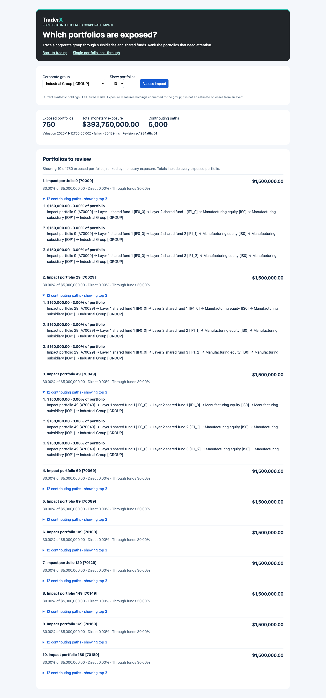

# Firm-wide impact: database-side aggregation experiment

Tracks issue #498 / draft PR #499. This follows the [full-path pilot](portfolio-impact.md), without changing the business question: which portfolios are exposed to a corporate group, and through which funds?

## Hypothesis and outcome

The full-path API moved every economic path to Python before returning only 20 portfolios and 3 explanations each. We tested whether aggregation and ranking inside the database, followed by selected explanation retrieval, would remove that avoidable cost.

**The query-design hypothesis is supported in these fixtures: both backends improve. A FalkorDB product advantage is still not demonstrated; PostgreSQL remains faster for the aggregate implementation.** This is a comparison of these implementations and clients, not a universal database ranking.

At 10,000 portfolios, the aggregate strategy improves the median by approximately 3.9× for PostgreSQL and 9.3× for FalkorDB. Compare those gains within each backend separately from the difference between backends.

## Paired design

Use the same analytical fixtures as the previous pilot, with portfolio count and fund depth varied independently. Each run uses the same source revision for all four conditions: PostgreSQL/full paths, FalkorDB/full paths, PostgreSQL/aggregate, FalkorDB/aggregate. Every condition must match the independent analytical totals, ranking and selected explanation paths before and during timing.

The old strategy is retained as `Engine.impact_paths`; the public `/api/impact` now uses the aggregate strategy with the same response shape:

1. Compute complete per-portfolio fractions, direct exposure, path counts, monetary ranking and all-book totals inside the database. SQL carries weights and a fund flag through a recursive CTE; Cypher aggregates paths in the graph server. Both return only the selected ranking plus global totals.
2. Start from the selected accounts and fetch their top explanation paths in one batch. Do not issue one request per portfolio or send all other portfolios' paths to Python.

Projected portfolio values are stored atomically with weights and node kinds. Both phases run under the engine's projection lock. Graph loss during either phase fails closed and invalidates the projection for reconciliation; it must not produce zero exposure or totals with missing explanations. The single-instance-per-database restriction remains.

## Results

13 November 2026, ARM64 macOS host, Python 3.14.3, PostgreSQL 16.4, FalkorDB 4.16.0, psycopg 3.2.10 and redis-py 6.4.0. The Redis client has no hiredis extension installed. Four rounds cyclically rotate all four condition orders; three warmups and ten timed samples per condition per round (40 samples per condition). Timing begins after generation and validation; other desktop services and the small demo APIs remain running.

Times include database requests, decoding and response formatting, but not source refresh, payload instrumentation or browser/HTTP rendering. This is sequential shared-host work, not concurrent capacity testing. Full raw samples, per-round summaries, plans and source hashes are linked below. Median / p95 values are milliseconds.

| Accounts / fund layers | PostgreSQL paths | PostgreSQL aggregate | FalkorDB paths | FalkorDB aggregate | Evidence |
| --- | ---: | ---: | ---: | ---: | --- |
| 1,000 / 1 | 5.144 / 7.073 | 3.396 / 3.952 | 26.812 / 28.690 | 6.263 / 7.440 | [JSON](aggregation-1000-layers-1.json) |
| 1,000 / 3 | 30.040 / 34.558 | 10.649 / 12.684 | 229.920 / 243.747 | 33.834 / 35.011 | [JSON](aggregation-1000-layers-3.json) |
| 10,000 / 3 | 334.783 / 355.087 | 86.930 / 89.689 | 2155.450 / 2189.453 | 230.657 / 236.563 | [JSON](aggregation-10000-layers-3.json) |

## Result transfer

One **untimed** probe captures the decoded database results and re-encodes them as compact JSON. These numbers are a logical payload proxy, **not wire bytes**, driver memory usage or a measurement of network throughput. The graph and SQL protocols differ, so do not interpret the byte ratio as a protocol comparison.

For the 10,000-portfolio / 140,000-path fixture:

| Condition | Database queries | Logical JSON bytes returned |
| --- | ---: | ---: |
| postgres/paths | 1 | 10,995,001 |
| falkor/paths | 1 | 9,847,505 |
| postgres/aggregate | 2 | 6,257 |
| falkor/aggregate | 2 | 4,775 |

The aggregate design returns a ranking summary and only the selected explanations, so result transfer stays small as unrelated returned paths grow. It still computes all relevant aggregates and enumerates candidate explanations inside the database. This does not eliminate path explosion or bound server memory by the UI response limit.

## Interpretation and next leads

This changes aggregation location, ranking, path materialization and result transfer together. It measures the combined strategy effect, not the isolated contribution of network, parser or server execution costs.

This narrows the cause of the earlier gap: moving and decoding all graph paths was an avoidable implementation cost. It does not establish that graph traversal is inherently worse, or that FalkorDB now provides a compelling product advantage. Both server execution and client behavior contribute to the end-to-end result.

The next controlled leads are:

- **Client overhead:** separately compare redis-py's current parser with an accelerated parser, holding queries and fixtures fixed. Do not mix a driver change into this query-strategy result or assume its effect without measurement.
- **Connectivity-only discovery:** identify affected portfolios without weighted path enumeration, then value/explain selected portfolios. This is a different business response and must be measured as a separate hypothesis against equivalent indexed SQL.
- **Concurrency and freshness:** measure realistic reads and source updates together, against an agreed product response-time/freshness target. Single-client medians cannot establish operational value.

No user-facing SLA has been agreed, and the PR remains draft. Firm-wide 100k, concurrent load and full C2 trading end-to-end regression remain unrun.

## Validation and screenshots

Seven real PostgreSQL/FalkorDB tests cover analytical answers, exact full-path/aggregate parity, bounded explanations with complete totals, empty results, position/fund updates, invalid input, unavailable state, and graph loss during either query phase with recovery. The fixture exceeds 10,000 paths. Original nine-test suites pass on demo and small profiles. Both states regenerate sequentially; Compose, dry-run, repository gates, lineage and lifecycle checks pass. Browser checks pass against both built-container backends, including mobile and single-portfolio navigation. CI includes a small paired comparison as a correctness check, not a performance gate.

The UI contract is unchanged. These fresh screenshots show the aggregate implementation on the default 1,000-portfolio/two-layer fixture; they are not timing evidence for the three-layer benchmark.




## Reproduce

For each fixture, point `EXPOSURE_TEST_DSN` at its own TraderX-initialized disposable database and `EXPOSURE_TEST_REDIS_URL` at a disposable FalkorDB instance. Install the exposure-service requirements, then run:

```bash
python scripts/benchmark-exposure-aggregation.py --accounts 1000 --layers 1 --output aggregation-1000-l1.json
# Change the DSN to a separate initialized database for each different fixture.
python scripts/benchmark-exposure-aggregation.py --accounts 1000 --layers 3 --output aggregation-1000-l3.json
python scripts/benchmark-exposure-aggregation.py --accounts 10000 --layers 3 --output aggregation-10000-l3.json
```

The benchmark seeds once and checks existing fixture contents through analytical results; it does not reset source data. The integration test script resets its database and must only target disposable test data. Historical reports retain their original source hashes; the new reports identify the code used for this comparison.
