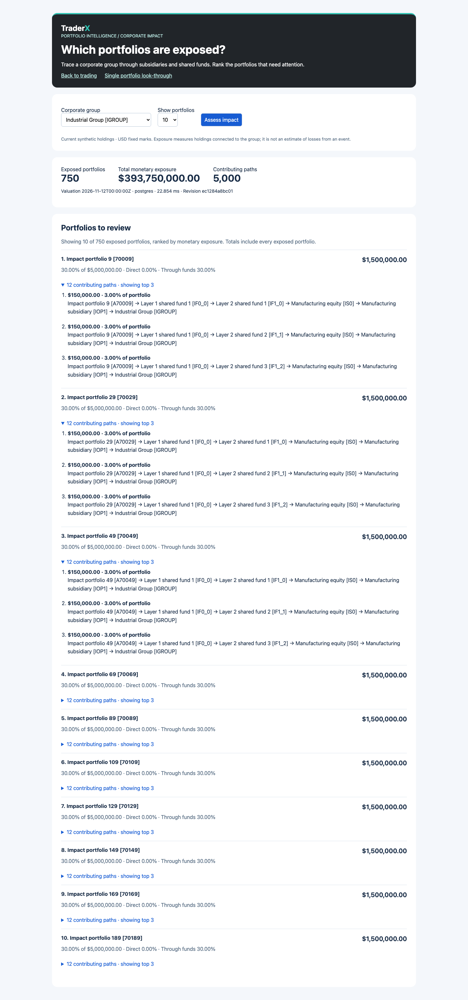

# Firm-wide corporate impact: first controlled pilot

Status: **draft**, issue #498 / PR #499. This is the historical full-path pilot; the [paired aggregation follow-up](portfolio-impact-aggregation.md) now tests the next design and the public API uses that aggregate strategy. Primary task confirmed: **which portfolios are exposed to a corporate group, and through which funds?**

## Hypothesis and finding

Reverse traversal through shared funds might improve firm-wide impact analysis enough to justify a graph read model. This pilot **does not support that hypothesis for the current path-enumerating implementation**: indexed recursive PostgreSQL is faster end to end in all three measured fixtures. This is not a proof that PostgreSQL wins every graph workload or every implementation of this task.

The useful next comparison is database-side aggregation with explanation retrieval only for the ranked portfolios, implemented equivalently for SQL and Cypher. Do not select a more spectacular graph merely to manufacture a win. A representative topology and a business latency/freshness requirement still need domain review.

## Fixture and fair comparison

Synthetic, fixed-mark USD positions: one quarter direct corporate exposure, one quarter two shared-fund holdings plus unrelated assets, one quarter mixed direct/fund exposure, and one quarter unexposed. Larger fund-oriented portfolios make the hidden concentration visible in monetary rankings. Two subsidiaries roll up to the selected corporate group. Every terminal fund holds 30% in one subsidiary, 20% in the other, and 50% unrelated holdings.

Fund depth and portfolio count vary independently; economic fractions and allocation rules stay constant. There are 750 exposed portfolios per 1,000 accounts, with $393,750,000 of group exposure; at 10,000 accounts these become 7,500 and $3,937,500,000. Expected totals, per-account fractions, rankings and path counts are analytical, independent of either engine. This is an explanatory synthetic topology, not a claim that 75% of a real book is exposed to one group.

Both backends perform **one reverse traversal**, not a loop over portfolios. PostgreSQL uses an index on projected edge targets with fresh statistics; Cypher uses an indexed target lookup and `WITH` to anchor traversal. Both return paths to the same Python aggregation/ranking code. The API returns the top 20 portfolios and up to 3 paths each, but computes complete totals before applying those limits.

## Method and results

13 November 2026, macOS ARM64 (10 logical CPUs), Python 3.14.3, PostgreSQL 16.4 and FalkorDB 4.16.0 under Docker Desktop. Three rounds of 20 timed requests per backend, three warmups per round, alternating backend order (SQL first, graph first, SQL first). Final timing runs followed generation/tests rather than overlapping those jobs; other desktop services and the small demo APIs remained running. These are shared-host sequential pilots, not capacity tests or confidence intervals.

Times include database transport, client decoding, full path enumeration, shared aggregation and bounded explanation formatting. They exclude source refresh and HTTP/browser rendering. The report records raw samples, per-round summaries, SQL `EXPLAIN ANALYZE`, Cypher `EXPLAIN`, source-file hashes and the source revision. Query errors are retained as failures rather than dropped. All final runs matched the analytical answers.

| Accounts | Fund layers | Paths | PostgreSQL median / p95 (ms) | FalkorDB median / p95 (ms) | Evidence |
| ---: | ---: | ---: | ---: | ---: | --- |
| 1,000 | 1 | 2,000 | 5.309 / 7.669 | 27.398 / 30.724 | [JSON](impact-1000-layers-1.json) |
| 1,000 | 3 | 14,000 | 30.430 / 35.831 | 232.174 / 242.370 | [JSON](impact-1000-layers-3.json) |
| 10,000 | 3 | 140,000 | 375.516 / 392.441 | 2160.500 / 2203.147 | [JSON](impact-10000-layers-3.json) |

| Fixture | Initial projection SQL / graph (s) | Shared-fund update SQL / graph (s) |
| --- | ---: | ---: |
| 1,000 / 1 layers | 0.048 / 0.103 | 0.036 / 0.067 |
| 1,000 / 3 layers | 0.037 / 0.064 | 0.041 / 0.066 |
| 10,000 / 3 layers | 0.130 / 0.616 | 0.155 / 0.632 |

No unhealthy interval was observed during these small-fixture update samples (10 ms health polling). This is not a guarantee of continuous availability or a concurrent read/update test. The earlier 100k profile has a much larger projection; its costs must not be substituted for this fixture or vice versa.

## Correctness and performance discoveries

A rejected first run returned incomplete graph results: FalkorDB's default `RESULTSET_SIZE=10000` silently capped the one-row-per-path response at 10,000 while the correct result had 14,000 paths. Analytical checks rejected the run. The path queries now collect results into one row to avoid that row cap, and the regression tests explicitly exceed it. The server configuration was not relaxed. Collecting paths preserves correctness but does not bound memory or make path enumeration cheap.

A separate [FalkorDB diagnostic profile](impact-falkor-profile-1000-layers-3.json) shows the indexed target lookup and reverse-traversal operator. It is **not** a decomposition of the timing-table samples. Server operator times exclude important transport/decoding/application costs; a fast graph operator alone is not a fast user-facing operation.

This implementation materializes every contributing path before ranking. It therefore tests a concrete API design, including the Python clients, rather than isolating graph traversal alone. Server-side aggregation and selective explanations are the next justified design comparison for **both** databases. Concurrency, cold caches, realistic event mixes and incremental synchronization remain untested.

## Validation and UI

Five real-database firm-wide tests cover analytical totals/rankings, exact path agreement, truncation invariance, empty results, position and shared-fund updates, invalid requests, unavailable reads and graph loss/recovery. The regression fixture has 14,000 paths. The original nine-test suite passed on both demo and small profiles; the three dataset-control tests passed. Both states regenerated sequentially, with valid Compose configuration and lifecycle dry-runs. Repository quality gates pass. Full C2 trading end-to-end regression remains unrun.

The independent TraderX-branded view is at `/exposure/impact`; the original lookup remains at `/exposure/`. Start with `EXPOSURE_PROFILE=impact` on a fresh initialized database for the default 1,000-account/two-fund-layer UI fixture. Screenshots below use that fixture (5,000 paths), not the three-layer benchmark. Browser checks cover dollar ranking, fund paths, full totals despite display limits, zero exposure, failure clearing, mobile layout and navigation to single-portfolio lookup.




## Reproduce

Initialize a **separate disposable TraderX PostgreSQL database** for each fixture; set `EXPOSURE_TEST_DSN` and `EXPOSURE_TEST_REDIS_URL`, install the exposure-service requirements, then run:

```bash
python scripts/benchmark-exposure-impact.py --accounts 1000 --layers 1 --output impact-1000-l1.json
# Change EXPOSURE_TEST_DSN to another freshly initialized database.
python scripts/benchmark-exposure-impact.py --accounts 1000 --layers 3 --output impact-1000-l3.json
# Change EXPOSURE_TEST_DSN again.
python scripts/benchmark-exposure-impact.py --accounts 10000 --layers 3 --output impact-10000-l3.json
```

The benchmark seeds once without resetting source data. `scripts/test-exposure-impact.py` does reset its test schema and must only target disposable databases. The PR remains draft while we evaluate the next design; no claim of a demonstrated product advantage for FalkorDB is made.
