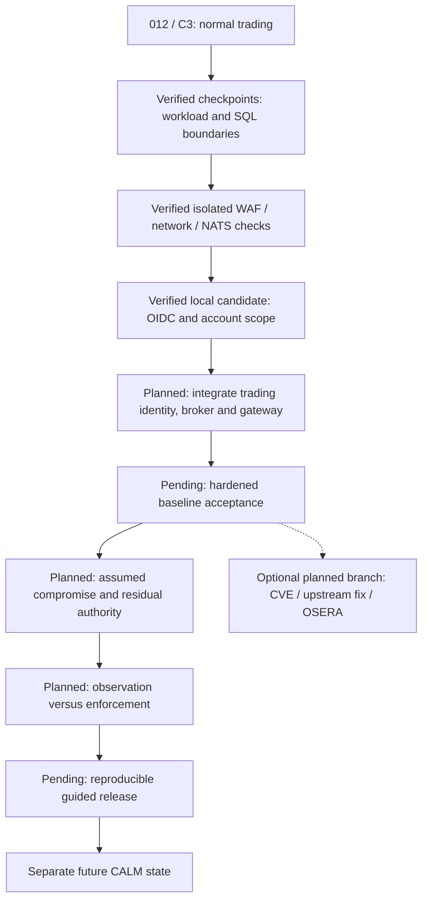

# Explore the boundaries

**Proposed State 019 · C3 child · in development.** Learn why a security layer allowed, blocked, detected or contained an action—and inspect what happened to the trading system.

The experiment console already supports bounded local demonstrations with synthetic data. The complete generated security state is **not yet accepted**. Some controls have verified isolated fixtures or candidate integrations; live trading authorization, authenticated messaging and runtime enforcement still need integration.

## See the experiment portal

*Actual local prototype captured on 23 November 2026. The cards are experiment entry points, not proof that all controls protect the live C3 deployment. The status banner makes that distinction visible. This documentation preview does not execute experiments or host a trading cluster.*

Choose an experiment, predict the outcome, run it locally and download its evidence. Each result should explain the active configuration, intervening layer, backend receipt, database/message effect and recovery. A failed or incomplete run cannot establish protection.

## Learn in phases

These arrows show learning dependencies. State 019 has one generation parent: C3. CALM will compare how an architecture model can drive the same controls; it does not replace the need to verify their enforcement.

| Phase | What you learn | Evidence boundary |
| --- | --- | --- |
| Establish normal behavior | Recognize a working baseline and synthetic dataset | Trading succeeds before security claims |
| Isolate one control | Compare allowed and denied operations | Fixture evidence does not prove live integration |
| Combine the controls | Keep trading working while eliminating bypass paths | Same pinned deployment passes positive and negative checks |
| Assume compromise | Test misuse through legitimate service authority | Inspect the canary and settled downstream effects independently |
| Compare runtime modes | Distinguish detection, containment and prevention | An alert or killed process alone does not prove prevention |
| Reproduce and reset | Explain the result and recover within a resource budget | Another learner repeats the outcome |

Track implementation and release gates in [GitHub issue #510](https://github.com/finos/traderX/issues/510).

## Start reviewing or experimenting

Read the [State 019 learning guide](learning/state-019-traderx-security-lab.md) and [prototype quickstart](/specs/traderx-security-lab/quickstart). The quickstart links supported prerequisites and explicit local certificate trust. Use lightweight checkpoints and one full cluster at a time; the full integrated walkthrough remains unavailable until its acceptance gates pass.

Review the [specification](/specs/traderx-security-lab/spec), [implementation tasks](/specs/traderx-security-lab/tasks) and [detailed checkpoint progression](/specs/platform-convergence-c3/security-lab/progression). Contributions should tie a requirement to a test, independent evidence and a stated limitation.

The intended community introduction is a short walkthrough: show the roadmap, run one positive control and one denial, inspect the evidence, then explain one residual-risk question. Add further screenshots and a captioned recording as those integrated scenarios become reproducible. The optional CVE/OSERA branch and supplier comparison will have separate acceptance criteria; neither is advertised as available today.
