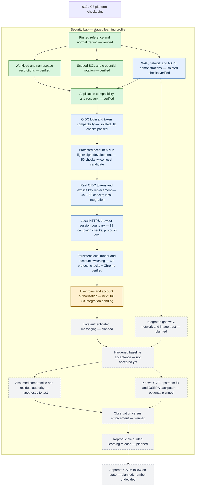

# Security Lab learning progression

This is the checkpoint roadmap for planned State 019, currently implemented as an experimental C3 profile. Checkpoints are not separate numbered states. Connections show learning dependencies, not generation parents; State 019 has C3 as its parent. Status reflects recorded checkpoint evidence, not a live health monitor.

Generated from `progression.json` with `scripts/security-lab/render_progression.py`; update those inputs, not this page.

**Legend:** green = verified within the stated scope; blue = isolated fixture only; amber = next implementation checkpoint; grey/dashed = planned. Text labels carry status as well as color. Dashed arrows are optional learning branches.

## Checkpoint questions and proof

| Checkpoint | Learner question | Acceptance evidence |
| --- | --- | --- |
| Pinned reference and normal trading | What constitutes a working baseline? | [baseline.lock.json](baseline.lock.json); [2026-11-22-c3-baseline-result.json](evidence/2026-11-22-c3-baseline-result.json) |
| Workload and namespace restrictions | What can a process do without root, capabilities or API tokens? | [workloads.md](contracts/workloads.md); [2026-11-22-candidate-c3-rollout.json](evidence/2026-11-22-candidate-c3-rollout.json) |
| Scoped SQL and credential rotation | Which database operations remain legitimate for each service? | [2026-11-22-rotated-database-permissions-result.json](evidence/2026-11-22-rotated-database-permissions-result.json) |
| WAF, network and NATS demonstrations | Which layer intervenes, and what does the fixture not prove? | [2026-11-22-waf-result.json](evidence/2026-11-22-waf-result.json); [2026-11-22-platform-result.json](evidence/2026-11-22-platform-result.json); [2026-11-22-nats-console.md](evidence/2026-11-22-nats-console.md) |
| Application compatibility and recovery | Does trading still work after client and image changes? | [2026-11-22-java-adapter-lifecycle.json](evidence/2026-11-22-java-adapter-lifecycle.json); [2026-11-22-candidate-c3-rollout.json](evidence/2026-11-22-candidate-c3-rollout.json) |
| OIDC login and token compatibility | Can a valid login be distinguished from an invalid or replayed token exchange? | [identity-fixture.md](contracts/identity-fixture.md); [2026-11-23-identity-provider.json](evidence/2026-11-23-identity-provider.json) |
| Protected account API in lightweight development | Do valid identities stay within assigned accounts, with denied writes leaving data unchanged? | [account-enforcement.md](contracts/account-enforcement.md); [2026-11-23-account-authorization.json](evidence/2026-11-23-account-authorization.json) |
| Real OIDC tokens and explicit key replacement | Does account scope survive real login and key replacement, and what still works during an issuer outage? | [2026-11-23-account-oidc-first.json](evidence/2026-11-23-account-oidc-first.json); [2026-11-23-account-oidc-rotation.json](evidence/2026-11-23-account-oidc-rotation.json) |
| Local HTTPS browser-session boundary | What does local browser logout invalidate, and which credentials remain usable? | [browser-session.md](contracts/browser-session.md); [2026-11-23-browser-session.json](evidence/2026-11-23-browser-session.json) |
| Persistent local runner and account switching | Can one browser session change users without retaining the previous account scope? | [2026-11-23-browser-persistent.json](evidence/2026-11-23-browser-persistent.json); [2026-11-23-browser-switch.json](evidence/2026-11-23-browser-switch.json); [2026-11-23-chrome-browser.json](evidence/2026-11-23-chrome-browser.json) |
| User roles and account authorization | Can an ordinary valid request access another account? | Planned; no result claimed |
| Live authenticated messaging | Can browser and service identities exceed their subject permissions? | Planned; no result claimed |
| Integrated gateway, network and image trust | Can a caller bypass the intended entry point or deployment policy? | Planned; no result claimed |
| Hardened baseline acceptance | Do positive trading and every selected negative check pass together? | Planned; no result claimed |
| Assumed compromise and residual authority | What harmful effects remain possible within legitimate service permissions? | Planned; no result claimed |
| Known CVE, upstream fix and OSERA backpatch | Does the same reproducible behavior disappear after a verified fix? | Planned; no result claimed |
| Observation versus enforcement | Which additional control prevents impact, and at what cost? | Planned; no result claimed |
| Reproducible guided learning release | Can another contributor reproduce, reset and explain the boundaries? | Planned; no result claimed |

## How to explore each phase

Predict an outcome, run the positive and negative checks, inspect the decision and resulting state, reset the synthetic data, then explain one remaining limitation. Advancement requires the checkpoint evidence; a green fixture does not mean the corresponding live C3 control is enabled.

The current console exposes individual experiments. A phase navigator, reproducible checkpoint switching and guided assessments remain planned; this diagram is not an implementation of those features.

Residual-risk exercises follow [the experiment contract](contracts/residual-risk.md). A successful assumed-compromise action is not proof of a real external exploit. Known-CVE reproduction has a separate verified-vulnerability gate. The CALM follow-on keeps the same tests and compares manual configuration with supported model-derived controls.
