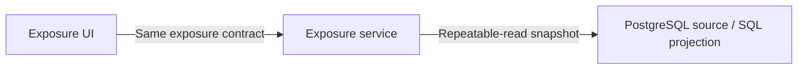

# Portfolio Look-Through

Explainable portfolio exposure on the C2 trading runtime.

- Inherits architectural baseline from: `009-order-management-matcher`
- Generated from: `system/architecture.model.json`
- Canonical flows: `system/end-to-end-flows.md`

## Architecture Diagram

## Node Catalog

| Node | Kind | Label | Notes |
| --- | --- | --- | --- |
| `ui` | service | Exposure UI | - |
| `api` | service | Exposure service | - |
| `pg` | service | PostgreSQL source / SQL projection | - |

