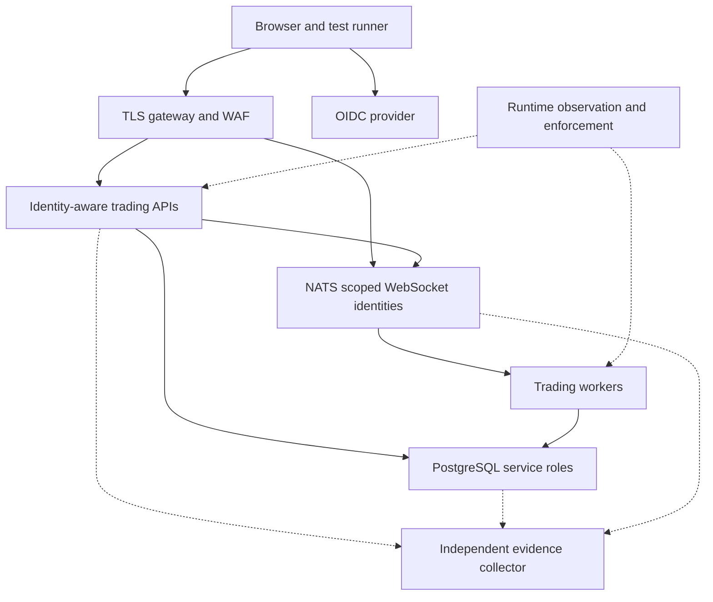

# Security Lab architecture

This is the target trust-boundary model, not a claim that every integration is live.

Application workloads have dedicated tokenless service accounts, restricted execution and bounded resources. Default-deny ingress/egress surrounds explicitly permitted dependencies. Operator routes are a separate access boundary. The assumed-compromise fixture shares only deliberately specified service authority; its evidence collector and reset authority remain outside that trust boundary.

Canonical detailed architecture and control inventory are in the [C3 profile system artifacts](../../012-platform-convergence-c3/security-lab/system/trust-boundaries.md). Generation of final deployment and derived architecture views is still pending.
