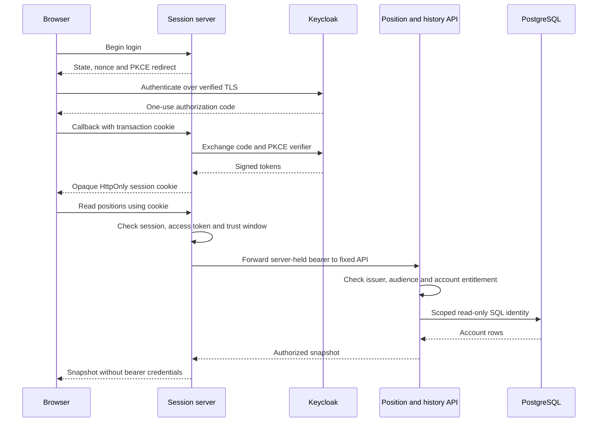

# Browser session and application API boundary

This opt-in candidate advances S019-04c. It does not publish State 019 or replace
the running local lab. Browser code receives an opaque, Secure, HttpOnly session
cookie and a CSRF value; access and ID tokens remain on the session server.

## Requirements

- BAPI-01: Use the existing authorization-code/PKCE and nonce/state checks against
  the pinned TLS Keycloak fixture. Revalidate the access token and finite signing
  key snapshot on protected requests; expired sessions fail closed.
- BAPI-02: Forward only enumerated account, position/history, order and market-data routes to
  explicitly configured backends. Never accept a caller-selected destination or
  forward caller authorization, role, account, cookie or forwarding headers.
- BAPI-03: Require the exact browser Origin and session CSRF token on mutations.
  Reject ambiguous paths, queries, request framing and duplicate JSON keys.
  Limit request bodies to 16 KiB and upstream responses to 2 MiB; do not follow
  redirects. Upstream errors must not disclose private responses or credentials.
- BAPI-04: Require verified HTTPS to backends, except an explicitly selected
  literal-loopback HTTP integration fixture. This exception is not deployment TLS.
- BAPI-05: Business authorization remains in each API. The browser session is not
  an account entitlement. Independently check same-account reads, cross-account
  denials, operator empty scope, direct unauthenticated backend denial and
  unchanged business tables against real PostgreSQL.
- BAPI-06: Keep existing account-only session behavior available. Candidate routes
  must be explicitly enabled; no wildcard proxy, operator/actuator routes, legacy
  booking endpoints or NATS credentials are exposed.
- BAPI-07: The generated Angular candidate waits for `/session`, maps application
  HTTP calls to the same-origin boundary and attaches the session CSRF value only
  to same-origin mutations. Sign-out, API 401 and the server-provided expiry clear
  the view and cancel outstanding application reads. No silent token refresh is
  implied. Use the mediated cookie-authorized notification endpoint described in
  `browser-broker-session.md`; never open the inherited anonymous NATS WebSocket.
- BAPI-08: Expose the explicit limit-order ticket through the authenticated matcher.
  Remove the legacy immediate-booking ticket and deny its `/trade-service/trade/`
  endpoint. The legacy path lacks the price and settlement contract of this
  profile; this is a deliberate change to the learner workflow, not full C3 parity.
  Require a finite positive price, whole positive quantity and the selected account;
  the matcher independently enforces all business permission and order rules.
- BAPI-09: Permit read-only `/reference-data/stocks` and `/price-publisher/prices`
  (optionally one bounded ticker segment) at fixed HTTPS origins. Order and selected
  quote views use bounded HTTP snapshots, refreshed after settlement/reconnect.
  Market quotes are informational and do not establish execution or authorization.
  Operator directory endpoints, forced fills and arbitrary queries remain absent.

## Acceptance sequence

1. Boundary tests exercise destination/path restrictions, TLS errors, redirects,
   bounded input/output and server-selected credentials against recording peers.
2. Hosted Linux runs real Keycloak login, the HTTPS session server, the generated
   Spring position/history API and scoped PostgreSQL login. Check all three
   subjects, CSRF rejection, logout/replayed cookies and database effects.
3. Connect the generated Angular session/CSRF client, then validate authenticated
   order submission, cancellation and settlement with application consumers.
4. Add scoped broker issuance/mediation, expiry and reconnect/revocation checks.
   Anonymous browser NATS is not an accepted substitute.

The first two gates prove session-to-read-API integration. They do not prove
browser UI navigation, live order execution, provider key rotation, refresh,
deployment supervision or complete cumulative trading. The development provider
is disposable; learner deployment and production issuer requirements remain
separate. Hosted fixtures run sequentially with bounded memory and owned cleanup;
no screen sharing, local image pulls or changes to Citrix are required.

## Learning checkpoint



Explain each outcome before moving to the broker checkpoint:

| Experiment | Layer to credit | Evidence |
| --- | --- | --- |
| Reader requests account 22214 | API account entitlement | Returned rows match independent scoped SQL count |
| Reader requests account 62654 | API authorization | HTTP 403; database fingerprint unchanged |
| Operator requests an account collection | Explicit business scope | Empty list, despite operator status |
| Mutation lacks a valid CSRF value or same origin | Session boundary | Rejected before forwarding |
| Session expires or its cookie is replayed after logout | Session boundary | Read denied; Angular cancels stale requests and removes views |
| Broker credentials are not yet integrated | Candidate fail-closed behavior | No anonymous WebSocket opens; the UI labels the missing live feed |

The live API campaign and Chrome component campaign are separate proofs. Chrome
tests use HTTP doubles and a routed-view stub; the live campaign uses real
Keycloak, Spring and PostgreSQL with an HTTPS cookie client. Neither establishes
a complete browser-to-trade-to-notification workflow. PostgreSQL's service role
does not establish the initiating user's business authorization; that distinction
still motivates the later residual-authority experiment.

The Linux workflow builds the pinned position candidate before invoking:

```bash
python scripts/security-lab/verify_browser_api.py --runtime-dir "$runtime" --output "$runtime/evidence/browser-api.json"
```

Use the existing isolated-runner preparation in `linux-integration.md`. The
campaign owns and removes its provider/database containers and Java process. It
uses fixture ports 18446/18447, refuses existing evidence, preserves private
credentials inside its temporary directory and exports only check names, source
hashes, pinned images and limitations. Do not run it beside an occupied browser
lab. This is an automated acceptance fixture, not a persistent learner launch
command. The generated Angular candidate is tested and built by the separate
`application-consumers` workflow job.
