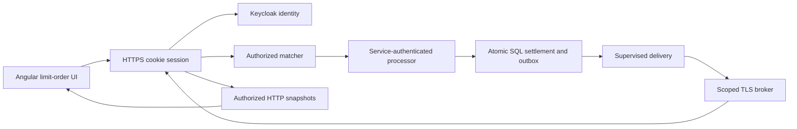

# Phase 1 and Phase 2 acceptance boundary

These phases advance FR-019-02, FR-019-14, FR-019-15 and FR-019-16. Keep the
retained C3 compatibility runtime available until the new candidate passes its
own acceptance. A component result must not silently become an integrated result.

## Phase 1: authenticated application journey

The learner signs in as a trader, selects an authorized synthetic account and
submits an explicit limit order. The actual matcher receives a scoped price,
uses its own service identity over TLS, and settles through the processor. The
transaction commits the trade, position, receipt and outbox events. Supervised
delivery reaches the broker; the session service forwards only invalidation
metadata. The actual Angular view then fetches authorized authoritative snapshots.

The same campaign must exercise read-only and operator identities, rejected
cross-account operations, cancellation, logout/expiry, broker reconnect and
recovery after a worker/service restart. Observe final SQL and consumer effects
independently; an HTTP success or notification alone is insufficient. Accepted
order authority intentionally can survive browser logout: cancel the stored
order through its authorized operation to revoke pending business intent.

Separate live-provider/API, matcher/processor, broker, worker and Chrome component
campaigns are necessary checkpoints. They do not substitute for this combined
browser journey. A synthetic scoped price producer is an explicit fixture;
complete C3 market-data provisioning is a later composition input.

## Phase 2: the same journey inside enforced deployment boundaries

Use one isolated supported cluster with a pinned source/image inventory, private
credentials, verified TLS, initialized synthetic SQL, supervised workers and the
same application journey. Collect evidence outside the application workloads.

| Gate | Required observation |
| --- | --- |
| Artifact and configuration | Actual image digest matches verified OCI bytes; startup consumes the declared private configuration; actual Kubernetes Secret projections and `fsGroup`/`emptyDir` permissions, including inherited setgid bits and private runtime-home restart behavior, pass rather than being inferred from Docker tmpfs fixtures |
| Workload and image admission | Exact approved candidate accepted; altered image, privileges, command and configuration rejected |
| Gateway and identity | Approved application routes work; direct backend, broker and operator paths are unreachable to an ordinary client |
| WAF variation | Same inputs and application state in disabled, detect and block modes; backend receipt recorded separately |
| Network and broker | Required connections and subscriptions work; unrelated destinations, subjects and publications fail |
| Database authority | Required scoped operations succeed; unrelated tables and administrative operations fail |
| Recovery and records | Restart preserves data and external evidence; retry produces no extra trade or consumer effect |
| Resource budget | One full cluster; recorded disk/memory headroom and bounded test execution |

The OCI compiler initially emits zero replicas. Its admission campaign uses
clearly labeled synthetic OCI descriptors and unscheduled workloads to test the
real API schema and policy evaluation. That proves neither runnable application
images, CNI enforcement, image provenance signatures nor production deployment.
Private launcher and static-asset tests likewise do not replace a built-image
startup test. Each limitation remains visible in the exported evidence.

The [first Python image checkpoint](runtime-images.md) is deliberately narrower:
three actual OCI builds, verified browser HTTPS/static startup under restricted
mounts, and worker role/configuration rejection. [Its smoke contract](runtime-images-smoke.md)
does not establish successful image-based SQL/broker delivery. S019-06a3c requires
that positive path, including replay and restart. Its
[43-check hosted checkpoint](../evidence/2026-11-26-worker-image-delivery.json)
now passes; accepting those workers in the cumulative deployment still requires
the surrounding controls and application journey. The [real Angular journey](browser-journey.md)
runs actual source-built services independently of this packaging checkpoint.

## What follows

After these two acceptance gates, retain the identical controls and introduce the
bounded residual-authority canary. Then compare runtime observation/enforcement,
reset twice and finish the contributor learning/reproduction gate. Ingress and
service-mesh comparisons reuse these outcomes; CALM belongs to a separate
successor state. Neither comparison is required to call these first two phases
complete, and neither can replace their observed business outcomes.
